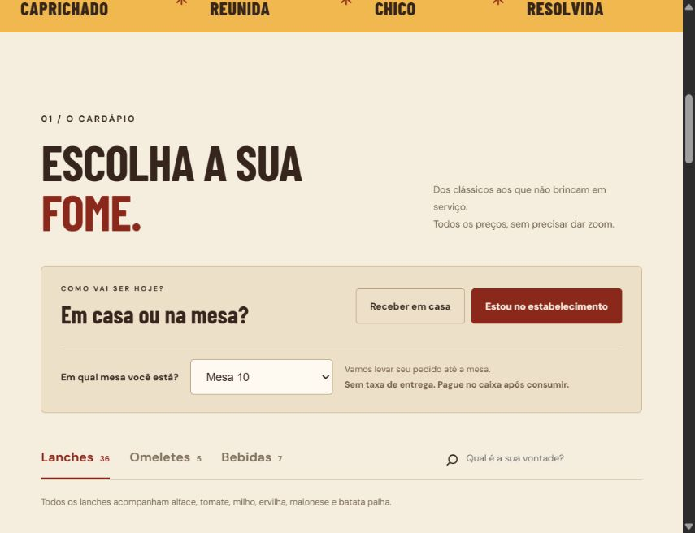

# Chico Burguer — cardápio digital e pedidos

Projeto web para uma hamburgueria com cardápio, carrinho, pedidos de delivery e salão e painel da equipe. Desenvolvido com React, TypeScript, JavaScript e SQL, com infraestrutura Cloudflare Workers e D1.

## Processo

Comecei pela identidade, pelo cardápio e pela jornada de escolha dos produtos. Depois conectei o fluxo de pedidos às regras do servidor e à persistência no banco, incluindo organização de mesas, acompanhamento e gestão da equipe. A cópia de estudo abaixo contém o código formatado e guias para acompanhar a implementação.

## Imagens




## Estágio e escopo

Esta é uma cópia para apresentação técnica e estudo. Não inclui banco publicado, dados de clientes, acesso real da equipe ou credenciais de hospedagem. As capturas podem conter dados fictícios de teste. Nomes, marcas e imagens pertencem aos respectivos titulares e não têm autorização geral de reutilização.

## Execução e documentação


Esta pasta contém o código-fonte da versão com delivery, pedidos no salão para as mesas 01 a 10, carrinho, cupons, login da equipe e painel de pedidos.

O código principal foi formatado e recebeu comentários. As regras do site foram preservadas. O HTML inicial, antes salvo em uma única linha, está legível em `app/home-markup.ts`.

## Comece por aqui

1. Leia [o mapa dos arquivos](docs/01-mapa-do-projeto.md).
2. Acompanhe [o caminho de um pedido](docs/02-caminho-do-pedido.md).
3. Rode o projeto seguindo [o guia local](docs/03-rodar-no-computador.md).
4. Pratique com [os exercícios](docs/04-exercicios.md).
5. Use [a lista das rotas](docs/05-rotas-e-dados.md) para localizar o comportamento do servidor.

## Os arquivos que você mais vai abrir

| Quero alterar... | Arquivo |
| --- | --- |
| Nomes, descrições e preços | `catalog.json` |
| Títulos, textos e estrutura da página | `app/home-markup.ts` |
| Cores e visual principal | `public/style.css` |
| Carrinho, salão, checkout e painel visual | `public/orders.css` |
| Comportamento do cliente | `public/app.js` |
| Comportamento da equipe | `public/admin.js` |
| Validação, autenticação e gravação | `lib/orders-api.ts` |
| Estrutura do banco | `db/orders-schema.ts` e `drizzle/` |

## Primeiro teste

Você precisa de Node.js 22.13 ou superior e npm. Dentro desta pasta:

```powershell
npm ci
npm run build
```

Depois prepare o banco local e o acesso da equipe conforme o guia. Por fim, use `npm run dev` e abra o endereço informado no terminal.

As alterações feitas aqui são locais. Publicar o site é um passo separado. Os dados dos clientes, senhas reais, banco da hamburgueria e credenciais de publicação não fazem parte desta cópia.

Referência do código original: revisão `e66fa76ffd845ad3c4e3402498badc896591ef93`, preparada em 04/11/2026.
