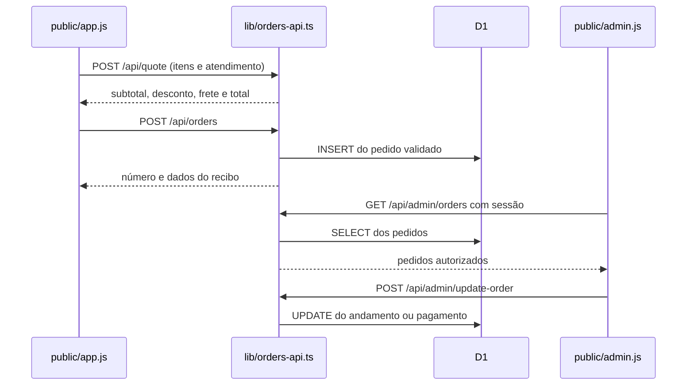

# 2. Acompanhe um pedido de ponta a ponta

## Exemplo: X-Tudo na mesa 04

1. O cliente escolhe **Estou no estabelecimento**. setService() muda serviceType para dine_in.
2. O cliente informa a mesa 04 e adiciona o X-Tudo. O carrinho guarda ID e quantidade.
3. refreshQuote() envia esses dados para POST /api/quote.
4. quote(), no servidor, procura o ID no catalog.json e usa seu preço de 2200 centavos. O cliente não decide o preço.
5. Como o atendimento é no salão, o frete é zero. O total é R$ 22,00.
6. checkout() pede nome e confirmação da mesa. Não pede endereço nem telefone. O pagamento é counter: no caixa após consumir.
7. sendOrder() envia a solicitação com uma chave de idempotência e um token de recibo.
8. checkoutSchema valida tudo de novo no servidor. A mesa precisa existir entre 1 e 10 e ser igual à mesa confirmada.
9. O servidor recalcula o total e grava o pedido com status received e payment_status pending.
10. O cliente recebe um número e consegue consultar seu recibo com o token.
11. O painel autenticado consulta os pedidos a cada 8 segundos. Um ID novo gera um aviso.
12. O atendente muda o andamento para preparo, pronto ou servido. O pagamento só passa para confirmado quando a equipe faz essa confirmação.

## E se for delivery?

serviceType é delivery, não há mesa e o formulário exige telefone e endereço. O pagamento pode ser cash ou card. A taxa vem da configuração do servidor; sem configuração, vale 500 centavos, ou R$ 5,00.

## Por que há duas validações?

A validação da tela ajuda a pessoa a preencher o formulário. A validação do servidor protege a regra do negócio mesmo que alguém envie uma requisição diretamente para a API.

## Por que guardar o preço dentro do pedido?

Os itens gravados são uma fotografia do que foi comprado. Se o catálogo mudar amanhã, o pedido anterior continua com seu preço original.

## Por que usar idempotência?

Um clique repetido ou uma tentativa reenviada por falha de conexão não deve criar dois pedidos. A chave única identifica a tentativa e o request_hash confere se os dados são os mesmos.

## Andamento e pagamento são coisas diferentes

Um pedido servido ainda pode estar pendente de pagamento, especialmente no salão. Por isso status e payment_status são campos separados.

O número mostrado ao cliente é formado pelos oito primeiros caracteres do ID. A coluna técnica number é um campo legado que recebe o horário da criação; não é o número mostrado na interface.
